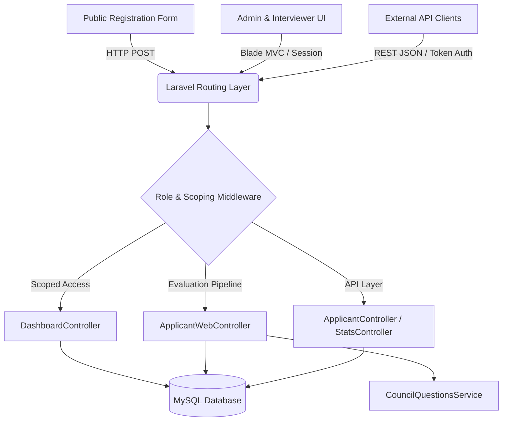

<p align="center">
  <a href="https://github.com/MohamedTBadr/ThreeDOS-Ushering-System">
    
  </a>
</p>

<h1 align="center">3DOS Ushering & Candidate Management System</h1>

<p align="center">
  <strong>An Enterprise Recruitment, Referral Attribution, Candidate Evaluation & Real-Time Analytics Platform</strong>
</p>

<p align="center">
  <a href="https://php.net"></a>
  <a href="https://laravel.com"></a>
  <a href="https://mysql.com"></a>
  <a href="https://tailwindcss.com"></a>
  <a href="LICENSE"></a>
</p>


---

## 📌 Executive Summary

The **ThreeDOS Ushering & Candidate Management System** is a robust, full-stack web application and RESTful API platform engineered to streamline member recruitment, event ushering attribution, interview evaluations, candidate decision pipelines, and executive performance analytics across all 3DOS academic and organizational councils.

Built with **Laravel 11**, **Blade MVC**, **Tailwind CSS**, and **MySQL**, the system provides a seamless experience for applicants, field ushers, interviewers, council heads, and executive VPs/Presidents.

---

## 📚 Technical Documentation Suite

For exhaustive technical specifications, architectural designs, and software requirements, refer to the dedicated documentation suite in the [`docs/`](docs/) directory:

| Document | Description | Target Audience |
| :--- | :--- | :--- |
| 📋 [**docs/PRD.md**](docs/PRD.md) | **Product Requirements Document** – Project vision, user personas, functional objectives, success metrics, and product roadmap. | Product Managers, Stakeholders, Executives |
| ⚙️ [**docs/SRS.md**](docs/SRS.md) | **Software Requirements Specification** – IEEE 830 compliant technical requirements, data models, system interfaces, and NFRs. | Software Architects, Developers, QA Engineers |
| 📐 [**docs/FDD.md**](docs/FDD.md) | **Functional Design Document** – Subsystem workflows, sequence diagrams, candidate evaluation matrix, and API specifications. | System Engineers, API Integrators, Tech Leads |

---

## ✨ Key Features

- 📝 **Public Applicant Registration:** Self-service registration form supporting academic level selection, event type targeting, and council preferences.
- 🎯 **Usher Referral Tracking:** Automatic attribution engine tracking candidates recruited by individual ushers via `ushered_by` credentials.
- 📋 **Dynamic Candidate Evaluation Engine:** Council-aware interview questionnaire matrix (`CouncilQuestionsService`) providing tailored soft skills and technical evaluation criteria (Marketing, Backend, Frontend, CEO, Stock Market, etc.).
- 📊 **Executive Analytics & Leaderboards:**
  - **Live Counter Dashboard:** Total applicants, accepted candidates, waitlisted (Backup B), rejected, and pending counts.
  - **Usher Performance Leaderboard:** Calculates recruit totals per usher, active usher count, and recruitment conversion averages.
  - **Interviewer Velocity Tracker:** Evaluates interviewer performance filtered against system users, partitioned by role (Instructors vs. Heads/VPs) and council breakdown.
- 🔒 **Dual Authentication & Scoping:**
  - **Web MVC:** Session-based authentication with role-based scoping (President/VP global access vs. Council Head council-scoped access).
  - **REST API:** Secure token-based API authentication (`AuthenticateToken` middleware).
- 📜 **System Audit Logging:** Captures system logs, user actions, authentication events, and rating modifications.

---

## 🏗️ System Architecture



---

## 🛠️ Technology Stack

- **Framework:** [Laravel 11.x](https://laravel.com/)
- **Programming Language:** [PHP 8.2+](https://php.net/)
- **Database Engine:** [MySQL 8.0+](https://mysql.com/) / MariaDB 10.5+
- **Frontend Template Engine:** Laravel Blade Templates
- **Styling & Assets:** Vanilla CSS / Tailwind CSS / [Vite](https://vitejs.dev/)
- **Package Management:** Composer & NPM
- **Testing Suite:** PHPUnit / Pest PHP

---

## 🚀 Quick Start & Installation Guide

### Prerequisites
Ensure your development environment meets the following requirements:
- **PHP** >= 8.2 (with OpenSSL, PDO, Mbstring, Tokenizer, XML, Ctype, JSON extensions)
- **Composer** >= 2.x
- **Node.js** >= 18.x & **NPM**
- **MySQL** >= 8.0

### Step-by-Step Installation

1. **Clone the Repository:**
   ```bash
   git clone https://github.com/MohamedTBadr/ThreeDOS-Ushering-System.git
   cd ThreeDOS-Ushering-System
   ```

2. **Install PHP & Node Dependencies:**
   ```bash
   composer install
   npm install
   ```

3. **Configure Environment File:**
   ```bash
   cp .env.example .env
   php artisan key:generate
   ```

4. **Setup Database Credentials:**
   Update your `.env` file with your MySQL database connection parameters:
   ```env
   DB_CONNECTION=mysql
   DB_HOST=127.0.0.1
   DB_PORT=3306
   DB_DATABASE=threedos_ushering
   DB_USERNAME=root
   DB_PASSWORD=your_password
   ```

5. **Run Database Migrations & Seeders:**
   ```bash
   php artisan migrate --seed
   ```

6. **Compile Frontend Assets & Launch Server:**
   ```bash
   npm run dev
   # In a separate terminal session:
   php artisan serve
   ```

   Navigate to `http://127.0.0.1:8000` in your web browser.

---

## 🗄️ Database Schema Summary

```
registrations
├── id (PK)
├── name, email (UNIQUE), phone, college, level
├── council, event_type, ushered_by
├── rating (ENUM: 'Pending', 'Acceptance', 'B', 'Rejection')
├── notes, interview_time, interviewed_by
├── interview_questions (JSON), interview_notes (JSON)
└── timestamps (created_at, updated_at)

councils
├── id (PK)
├── name (UNIQUE), description
└── timestamps (created_at, updated_at)

users
├── id (PK)
├── username (UNIQUE), email (UNIQUE), password, role, council
└── timestamps (created_at, updated_at)
```

---

## 🔌 API Endpoints Quick Reference

### Public API Endpoints
- `POST /api/registrations` – Submit candidate registration form
- `POST /api/auth/login` – Authenticate user and receive access token
- `POST /api/signup` – Register new system user
- `GET /api/councils` – Retrieve list of available councils

### Protected API Endpoints (Requires `AuthenticateToken` Header)
- `GET /api/registrations` – Retrieve paginated applicant list
- `PATCH /api/registrations/{id}` – Update applicant evaluation score & rating
- `GET /api/stats/ushers` – Retrieve usher performance statistics
- `GET /api/stats/interviewers` – Retrieve interviewer activity statistics
- `GET /api/logs` – Fetch system activity logs

---

## 📂 Project Directory Structure

```
ThreeDOS-Ushering-System/
├── app/
│   ├── Http/
│   │   ├── Controllers/         # API & Web Controllers
│   │   │   └── Web/             # Dashboard, Applicant, Auth Web Controllers
│   │   └── Middleware/          # AuthenticateToken Middleware
│   ├── Models/                  # Registration, Council, User, Session Eloquent Models
│   └── Services/                # CouncilQuestionsService (Question Matrix)
├── config/                      # Application Configuration Files
├── database/
│   ├── migrations/              # Database Schema Migrations
│   └── seeders/                 # Database Seeders
├── docs/                        # 📚 Enterprise Documentation Suite
│   ├── PRD.md                   # Product Requirements Document
│   ├── SRS.md                   # Software Requirements Specification
│   └── FDD.md                   # Functional Design Document
├── public/                      # Front Controller & Public Assets
├── resources/
│   ├── views/                   # Blade Layouts, Pages & Partials
│   └── css / js                 # Frontend Styles & Scripts
├── routes/
│   ├── web.php                  # Web MVC Routes
│   └── api.php                  # REST API Routes
└── README.md                    # Project Overview & Quick Start
```

---

## 🧪 Testing

To execute the automated test suite via PHPUnit:

```bash
php artisan test
```

---

## 📄 License

The 3DOS Ushering System is open-sourced software licensed under the [MIT License](LICENSE).
