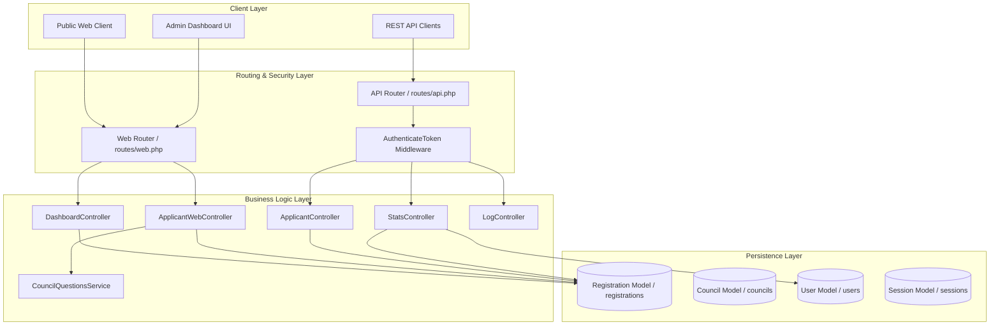
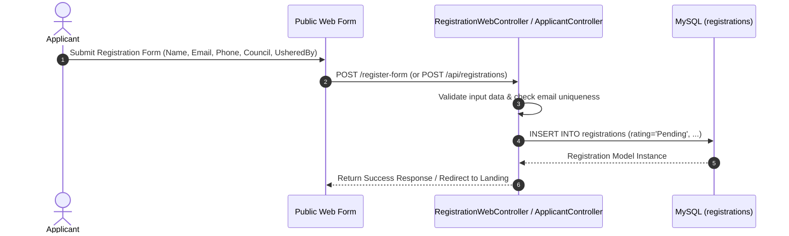
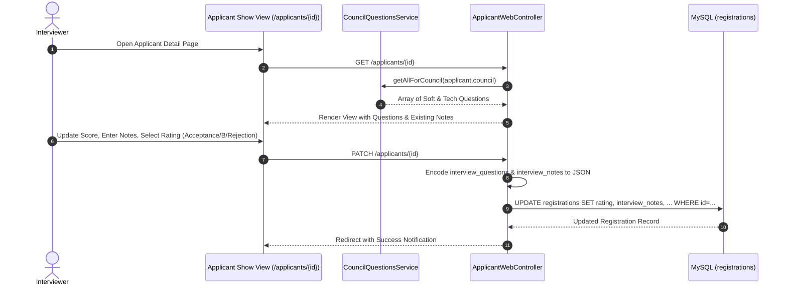

# Functional Design Document (FDD)

## Project Title: 3DOS Ushering & Candidate Management System
**Document Version:** 1.0.0  
**Status:** Approved  
**Focus Area:** Subsystem Architecture, Component Workflows, Data Structures & API Specifications  

---

## 1. Subsystem Architecture & Component Breakdown



---

## 2. Component Workflows & Sequence Specifications

### 2.1 Candidate Registration & Usher Attribution Sequence



### 2.2 Candidate Evaluation & Rating Submission Sequence



---

## 3. Data Schema & Question Engine Specifications

### 3.1 Council Questions Matrix (`CouncilQuestionsService`)
The system provides tailored question sets based on the candidate's chosen council. Each question object contains the following structure:

```json
{
  "id": "mkt_tech_2",
  "question": "Explain what SEO is and why it's important for digital marketing.",
  "category": "Tech Skills",
  "difficulty": "Medium",
  "council": "Marketing"
}
```

#### Council Support Table

| Council Key | Soft Skill Questions | Tech Skill Questions | Default Fallback Enabled |
| :--- | :--- | :--- | :--- |
| **Marketing** | 3 questions | 2 questions | No |
| **Backend Development** | 1 question | 1 question | No |
| **Frontend Development** | 1 question | 1 question | No |
| **CEO** | 1 question | 1 question | No |
| **Stock Market** | 1 question | 1 question | No |
| *Other / Generic* | Default Soft Set | Default Tech Set | **Yes** |

### 3.2 Evaluation Data Payload Example (`interview_notes` & `interview_questions`)

```json
{
  "rating": "Acceptance",
  "interviewed_by": "john_doe",
  "interview_time": "2026-09-18 14:30:00",
  "interview_questions": [
    {
      "id": "mkt_soft_1",
      "question": "Tell me about a time you had to persuade someone to accept your idea.",
      "score": 5,
      "comments": "Strong communication and clear example given."
    }
  ],
  "interview_notes": {
    "strengths": "Articulate, highly motivated, clear vision.",
    "areas_for_growth": "Needs deeper experience with paid ad analytics.",
    "final_recommendation": "Direct hire for Marketing Council lead team."
  }
}
```

---

## 4. Analytics Engine Specification

### 4.1 Usher Performance Calculation Algorithm
The usher analytics engine (`DashboardController::usherStats`) aggregates referral counts using the following query logic:

```sql
SELECT 
    ushered_by AS name, 
    COUNT(*) AS count 
FROM registrations 
WHERE 
    ushered_by IS NOT NULL 
    AND ushered_by NOT IN ('', 'NA', 'N/A', 'na', 'n/a', 'none', 'null', 'None') 
GROUP BY ushered_by 
ORDER BY count DESC;
```

### 4.2 Interviewer Performance & System Scoping Algorithm
To ensure legacy non-user entries do not contaminate interviewer leaderboards, `DashboardController::interviewerStats` performs double-tier scoping:
1. Fetches valid usernames from `User::pluck('username')`.
2. Filters `interviewed_by` values against system users.
3. Groups evaluation totals by user role (`Instructor` vs. `Head`/`VP`/`President`).

---

## 5. API Endpoint Specifications

### 5.1 Public API Endpoints

| Method | Endpoint | Description | Request Body / Parameters | Response |
| :--- | :--- | :--- | :--- | :--- |
| `POST` | `/api/registrations` | Public candidate registration | JSON applicant object | `201 Created` / `422 Unprocessable` |
| `POST` | `/api/auth/login` | System login (issues token) | `{ "username": "...", "password": "..." }` | `{ "status": "success", "token": "..." }` |
| `POST` | `/api/signup` | Create system user | User creation payload | `201 Created` |
| `GET` | `/api/councils` | Fetch all active councils | None | JSON array of councils |

### 5.2 Protected API Endpoints (Requires `AuthenticateToken` Header)

| Method | Endpoint | Description | Request Body / Parameters | Response |
| :--- | :--- | :--- | :--- | :--- |
| `GET` | `/api/registrations` | List paginated applicants | Query params (`page`, `search`, `council`, etc.) | JSON paginated array |
| `PATCH` | `/api/registrations/{id}` | Update applicant evaluation | JSON candidate update payload | JSON updated object |
| `GET` | `/api/stats/ushers` | Fetch usher stats JSON | None | JSON stats object |
| `GET` | `/api/stats/interviewers` | Fetch interviewer stats JSON | None | JSON stats object |
| `GET` | `/api/logs` | Fetch system audit logs | None | JSON logs array |
