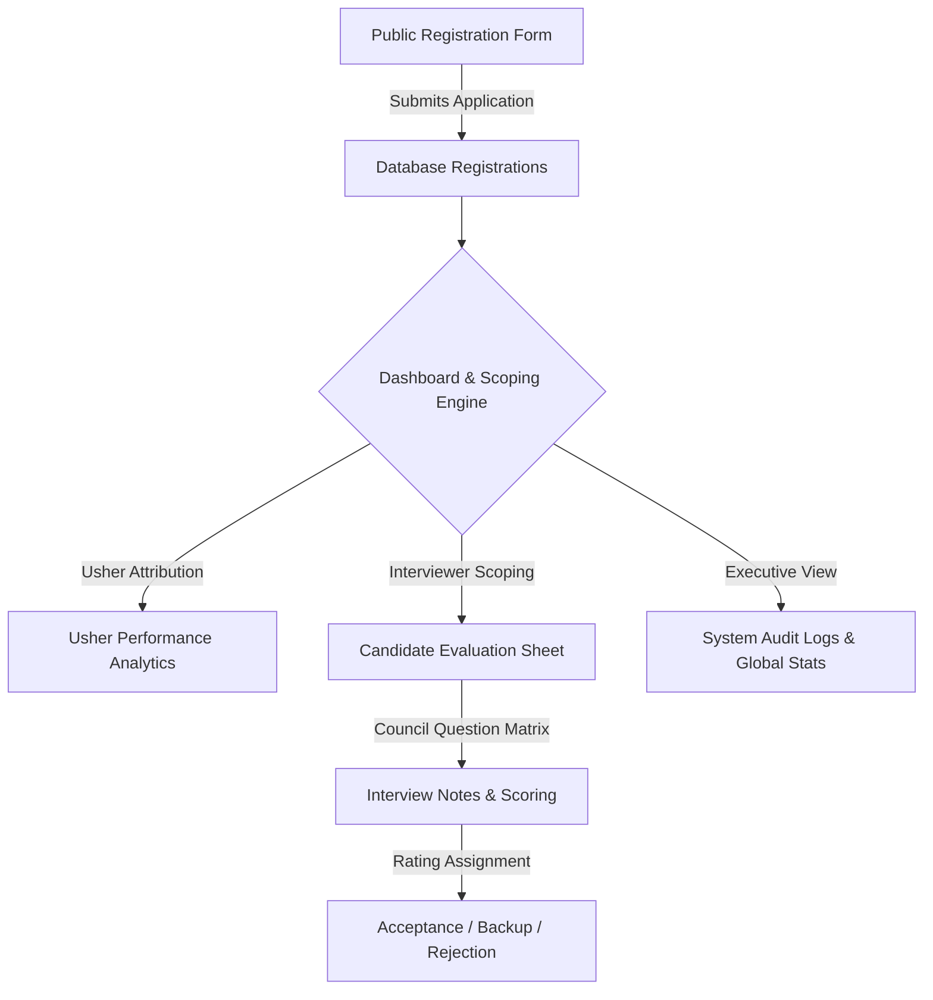

# Product Requirements Document (PRD)

## Project Title: 3DOS Ushering & Candidate Management System
**Document Version:** 1.0.0  
**Status:** Approved  
**Last Updated:** September 2026  
**System Baseline:** Laravel 11.x, PHP 8.2+, MySQL 8.0+, Tailwind CSS / Blade MVC  

---

## 1. Executive Summary & Product Vision

### 1.1 Overview
The **3DOS Ushering & Candidate Management System** is an enterprise-ready web platform and API service engineered to streamline member recruitment, event ushering, interviewer performance tracking, candidate evaluation, and analytics across all 3DOS academic and organizational councils.

### 1.2 Core Problem Statement
Prior to implementation, candidate recruitment and evaluation faced several operational bottlenecks:
- **Fragmented Applicant Tracking:** Manual collection of registration forms resulted in duplicate entries and lost candidate records.
- **Unstructured Interview Scoring:** Lack of standardized question rubrics and qualitative feedback capture for technical and soft skill assessments.
- **Lack of Usher Attribution:** Inability to credit specific ushers for recruiting candidates and measuring recruitment funnel conversion rates.
- **Opaque Analytics:** Executive leadership (VPs, Presidents, Council Heads) lacked real-time visibility into interviewer throughput, council capacity, and applicant rating distributions.

### 1.3 Strategic Vision
To deliver a unified, highly scalable, and secure recruitment platform that automates applicant acquisition, standardizes interview evaluations with council-specific question sets, tracks usher attribution, and provides real-time executive analytics for data-driven decision making.

---

## 2. User Classes & Persona Specifications

| Persona | Role | Key Responsibilities & Access Level |
| :--- | :--- | :--- |
| **System Admin / VP / President** | Executive Governance | Global access across all councils. Inspects high-level dashboards, manages user roles, views system audit logs, and monitors total conversion statistics. |
| **Council Head / Vice Head** | Council Manager | Scoped access to council applicants. Conducts interviews, updates candidate ratings (`Acceptance`, `B`, `Rejection`), and manages interview schedules. |
| **Instructor / Interviewer** | Evaluator | Conducts candidate interviews using built-in soft skill and technical question sets. Logs interview notes, scores, and candidate feedback. |
| **Usher / Recruiter** | Promoter | Drives applicant registration via referral links or field ushering. Tracked via `ushered_by` fields in registration records. |
| **Applicant / Candidate** | Public User | Submits registration details, selects target council and event type, and provides contact/academic info via public web form. |

---

## 3. Product Scope & Functional Feature Matrix

### 3.1 Public Registration & Ushering Funnel
- **Self-Service Application:** Public web interface allowing candidates to apply with name, email, phone, college, academic level, target council, and event type.
- **Usher Attribution Engine:** Mandatory/optional referral field (`ushered_by`) capturing the usher responsible for recruiting the candidate.
- **Validation & Duplicate Prevention:** Unique email constraint preventing duplicate registrations.

### 3.2 Candidate Evaluation & Rating Pipeline
- **Status Lifecycle:** Every candidate transitions through defined states:
  - `Pending` (Default state upon registration)
  - `Acceptance` (Qualified & selected candidate)
  - `B` (Waitlist / Backup pool candidate)
  - `Rejection` (Did not meet council requirements)
- **Council-Specific Question Bank:** Integrated question engine (`CouncilQuestionsService`) delivering tailored soft-skill and tech-skill evaluation questions for Marketing, Backend, Frontend, CEO, Stock Market, and generic councils.
- **Qualitative & Quantitative Feedback:** Captures granular candidate evaluation notes (`interview_notes`), question scores (`interview_questions`), interviewer identity (`interviewed_by`), and timestamp (`interview_time`).

### 3.3 Executive Dashboard & Real-Time Analytics
- **Live Metrics Counter:** Total applicants, accepted candidates, waitlisted (Backup B), rejected, and pending counts.
- **Advanced Filtering:** Multi-parameter filtering by search term (name/email), academic level, rating status, event type, and council.
- **Usher Performance Leaderboard:** Aggregates recruitment counts per usher, active ushers count, and average recruits per usher.
- **Interviewer Velocity Tracker:** Ranks interviewers by completed evaluation volume, partitioned by role (Instructors vs. Heads/VPs) and council breakdown.
- **Interview Calendar:** Timeline view of scheduled interviews.

### 3.4 Governance & Audit Log System
- **Role-Based Access Scoping:** Automatic scoping restricting Council Heads and Instructors to their assigned council while granting VP/President global access.
- **Audit Logs:** Tracks login attempts, applicant rating modifications, registration entries, and critical system events (`LogController` / `LogWebController`).

---

## 4. Key Performance Indicators (KPIs) & Success Metrics

1. **Recruitment Funnel Throughput:** Time taken from candidate application to interview rating completion (< 48 hours target).
2. **Interviewer Capacity Utilization:** Average interviews conducted per active instructor (tracked via Interviewer Stats leaderboard).
3. **Usher Referral Conversion:** Percentage of total applicants onboarded through designated ushers versus organic traffic.
4. **Rating Distribution Balance:** Target ratio between `Acceptance`, `B` (Waitlist), and `Rejection` states to prevent over-allocation.

---

## 5. Non-Functional Requirements (NFRs)

- **Performance:** Dashboard listing and filtered queries sub-200ms response time with paginated data fetching (20 records per page).
- **Data Integrity:** Database indexes on `rating`, `level`, `council`, and `email` columns for query optimization.
- **Security:** CSRF protection on web forms, custom token authentication middleware (`AuthenticateToken`) for API endpoints, input sanitization, and password hashing via bcrypt.
- **Usability:** Responsive UI built with Blade templates, Tailwind CSS, and clean navigation layouts.

---

## 6. Future Roadmap & Enhancements

- [ ] **Automated Notifications:** SMS and WhatsApp integration for sending interview scheduling reminders and acceptance/rejection letters.
- [ ] **QR-Code Check-In:** Self-check-in at event venues generating instant QR verification.
- [ ] **CSV / Excel Data Export:** One-click export of applicant rosters filtered by council or rating.
- [ ] **AI Applicant Summarizer:** AI-assisted synthesis of interviewer evaluation notes into executive executive summaries.
